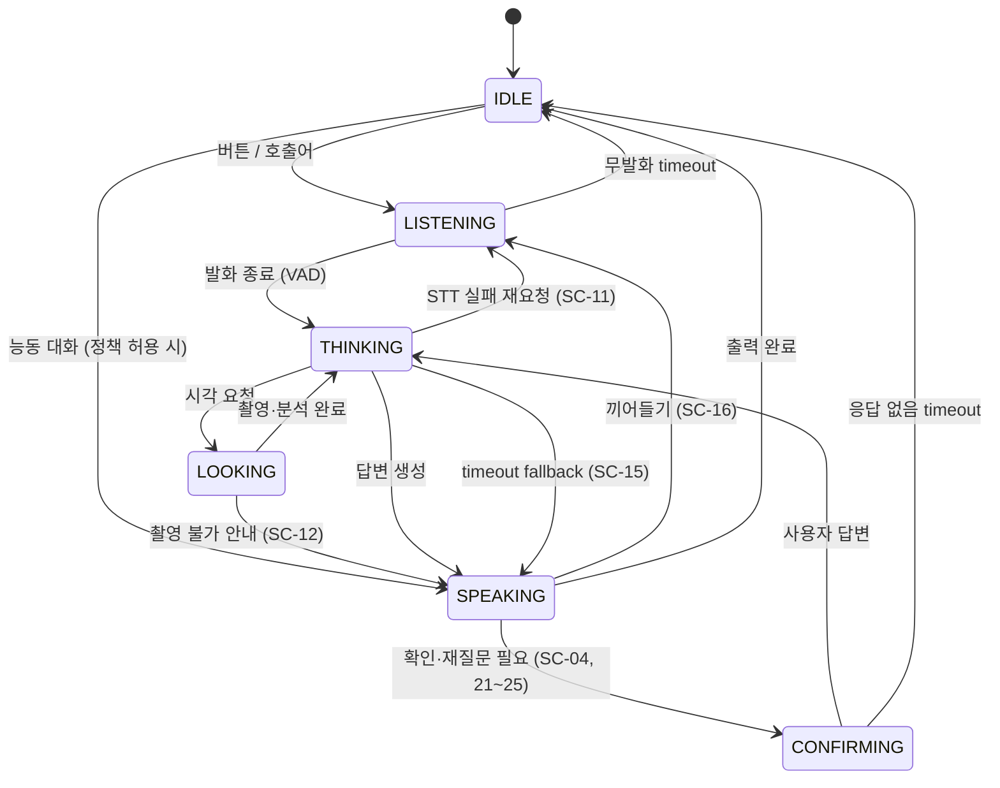
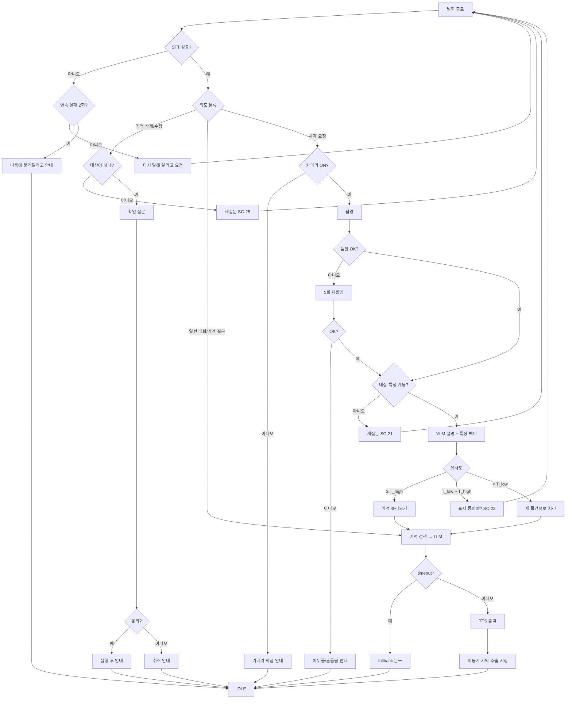

# 세부 시나리오

기준: [대표 시나리오 SC-00](golden-scenario.md)
번호 규칙: `SC-0x` 정상, `SC-1x` 예외, `SC-2x` 불명확 요청

| ID | 분류 | 제목 | SC-00 분기 지점 | 관련 정책 |
|---|---|---|---|---|
| SC-01 | 정상 | 처음 보는 물건 소개 + 기억 저장 | 1막 전체 | POL-06 |
| SC-02 | 정상 | 같은 물건 다시 알아보기 | 2막 전체 | — |
| SC-03 | 정상 | 기억만으로 답하기 ("몽이 기억나?") | 2막 변형 | — |
| SC-04 | 정상 | 기억 삭제 | 기억 관리 | POL-01 |
| SC-05 | 정상 | 일정 기억 + 능동 대화 | 확장 | POL-05 |
| SC-11 | 예외 | 음성 인식 실패 (소음, 너무 짧음) | 2단계 | POL-03 |
| SC-12 | 예외 | 촬영 불가 (카메라 OFF, 어두움, 흔들림) | 3단계 | POL-03, POL-06 |
| SC-13 | 예외 | 물건을 알아보지 못함 | 3단계 | POL-04 |
| SC-14 | 예외 | 비슷한 다른 물건 | 8단계 | — |
| SC-15 | 예외 | 모델 응답 timeout / 메모리 부족 | 전체 | POL-04 |
| SC-16 | 예외 | 펫이 말하는 중에 사용자가 끼어듦 | 4·9단계 | — |
| SC-21 | 불명확 | "이거"가 무엇인지 불명확 (화면에 대상 없음, 여러 개) | 7단계 | POL-02 |
| SC-22 | 불명확 | 유사도가 애매함 → 확인 질문 | 8단계 | POL-02 |
| SC-23 | 불명확 | 이름을 알려주지 않음 | 5단계 | POL-02 |
| SC-24 | 불명확 | 기존 기억과 충돌 ("얘 이름 사실 콩이야") | 6단계 | POL-01, POL-02 |
| SC-25 | 불명확 | 대상이 모호한 삭제 요청 ("그거 지워") | 기억 관리 | POL-01, POL-02 |

---

## 정상 흐름

### SC-01 처음 보는 물건 소개 + 기억 저장
- **사용자 입력:** 버튼 → "얘 봐봐. 귀엽지?" + 인형을 보여줌 → "어릴 때부터 갖고 있던 몽이야."
- **시스템 처리:** STT → 의도 = 시각 요청 → 촬영 → VLM 설명·특징 벡터 → 시각 기억 검색(일치 없음) → LLM 답변 → TTS → (비동기) 기억 후보 추출 → 중복 확인 → 시각 기억 + 장기 기억 저장 및 연결
- **최종 출력:** "귀엽다! 갈색 곰돌이네. 얘 이름은 뭐야?" → "몽이구나. 오래 같이 지냈네."
- **성공 조건:** 기억 화면에 "몽이 / 어릴 때부터 가진 곰 인형" 1건 저장, 중복 없음. 원본 사진은 썸네일만 저장.

### SC-02 같은 물건 다시 알아보기
- **사용자 입력:** 앱 재시작 후 버튼 → "이거 누군지 알아?" + 같은 인형
- **시스템 처리:** 촬영 → 특징 벡터 → 유사도 ≥ 확정 기준(T_high) → 연결된 장기 기억 불러오기 → LLM
- **최종 출력:** "어? 몽이잖아! 어릴 때부터 같이 있었다고 했지?"
- **성공 조건:** 각도·조명을 바꿔 5번 보여줬을 때 4번 이상 이름으로 알아봄.

### SC-03 기억만으로 답하기
- **사용자 입력:** (인형을 보여주지 않고) "몽이 기억나?"
- **시스템 처리:** 의도 = 기억 질문 → 촬영하지 않음 → 장기 기억 텍스트 검색 → LLM
- **최종 출력:** "당연하지. 네가 어릴 때부터 갖고 있던 곰 인형이잖아."
- **성공 조건:** 카메라를 켜지 않음. 저장된 내용 외의 사실을 지어내지 않음.

### SC-04 기억 삭제
- **사용자 입력:** "몽이 기억 지워줘."
- **시스템 처리:** 의도 = 기억 삭제 → 대상 검색(1건) → **확인 질문** → "응" → 시각 기억 + 장기 기억 삭제
- **최종 출력:** "몽이에 대한 기억을 지울까?" → "지웠어."
- **성공 조건:** 삭제 후 같은 인형을 보여주면 SC-01처럼 처음 보는 물건으로 반응함. "아니"라고 답하면 삭제하지 않음.

### SC-05 일정 기억 + 능동 대화
- **사용자 입력:** "나 내일 시험이야."
- **시스템 처리:** 일정 기억 저장(날짜 = 내일) → 스케줄 등록 → 다음 날 설정 시간대에 능동 대화 정책 확인 → LLM → TTS
- **최종 출력:** 당일: "그렇구나, 응원할게!" / 다음 날: "오늘 시험이지? 잘 보고 와."
- **성공 조건:** 취침 시간이나 능동 대화 OFF일 때는 말하지 않음. 하루 최대 횟수 준수. (시연 시 시간을 조작해 검증)

---

## 예외 상황

### SC-11 음성 인식 실패
- **사용자 입력:** 시끄러운 곳에서 발화, 또는 1초 미만 발화
- **발생 조건:** STT 결과가 비었거나 신뢰도 < 기준
- **시스템 처리:** LLM을 호출하지 않음 → 재요청 문구 출력 → LISTENING으로 복귀. 2번 연속 실패하면 IDLE.
- **최종 출력:** "잘 못 들었어. 한 번만 다시 말해줄래?" → (2회차) "주변이 좀 시끄러운 것 같아. 나중에 다시 불러줘."
- **성공 조건:** 엉뚱한 답변을 만들지 않음. 무한 재시도하지 않음.

### SC-12 촬영 불가
- **발생 조건:** ① 카메라 설정 OFF ② 너무 어두움 (평균 밝기 < 기준) ③ 흔들림 (선명도 < 기준) ④ 카메라 연결 끊김
- **시스템 처리:** ① 촬영하지 않고 안내 ②③ 1회 자동 재촬영 → 그래도 실패하면 안내 ④ 휴대폰 카메라로 전환 가능 시 전환
- **최종 출력:** ① "지금 카메라가 꺼져 있어. 설정에서 켜줄래?" ② "너무 어두워서 잘 안 보여." ③ "흔들려서 잘 안 보였어. 잠깐 멈춰줄래?"
- **성공 조건:** 카메라 OFF일 때는 절대 촬영하지 않음. 품질이 낮은 사진으로 추측해 답하지 않음.

### SC-13 물건을 알아보지 못함
- **발생 조건:** VLM 설명의 신뢰도가 낮거나 "알 수 없음"
- **시스템 처리:** LLM에 "불확실" 표시를 함께 전달 → 추측임을 밝히는 답변 → 사용자 답을 기억에 저장
- **최종 출력:** "음… 인형 같기도 한데 잘 모르겠어. 이거 뭐야?"
- **성공 조건:** 확신하지 못하는 내용을 단정하지 않음.

### SC-14 비슷한 다른 물건
- **사용자 입력:** 몽이와 비슷한 다른 곰 인형을 보여줌
- **시스템 처리:** 유사도 < 애매 기준(T_low) → 새 물건으로 처리. T_low ≤ 유사도 < T_high면 SC-22로.
- **최종 출력:** "처음 보는 곰돌이네! 몽이 친구야?"
- **성공 조건:** 다른 물건을 몽이로 단정하지 않음. (오인식률 목표는 NFR에서 정의)

### SC-15 모델 응답 timeout / 메모리 부족
- **발생 조건:** LLM 첫 토큰 또는 VLM 결과가 timeout 초과, 또는 모델 로딩 실패(OOM)
- **시스템 처리:** 요청 취소 → 준비된 짧은 안내 문구 출력(TTS 실패 시 미리 녹음한 효과음) → 에러 로그 기록 → OOM이면 VLM을 내리고 LLM만 다시 로딩
- **최종 출력:** "잠깐 머리가 멈췄어. 다시 말해줄래?"
- **성공 조건:** 앱이 종료되지 않음. 무응답 상태로 timeout 이상 멈춰 있지 않음.

### SC-16 끼어들기
- **사용자 입력:** 펫이 말하는 중에 버튼을 누르거나 말하기 시작
- **시스템 처리:** SPEAKING 중 VAD가 SPEECH_START 감지 (스피커 소리 재입력은 제외) → TTS 중단 + LLM 생성 취소 → LISTENING
- **최종 출력:** 즉시 말을 멈추고 새 발화를 들음
- **성공 조건:** 펫 자신의 목소리로는 끼어들기가 발생하지 않음.

---

## 불명확한 요청

### SC-21 "이거"가 무엇인지 불명확
- **사용자 입력:** "이거 뭐야?" (카메라에 대상이 없음 / 물건이 여러 개)
- **모호한 점:** 지칭 대상을 특정할 수 없음
- **재질문:** 대상 없음: "어떤 거? 카메라 앞에 보여줄래?" / 여러 개: "컵이랑 인형이 보이는데, 어느 거?"
- **최종 출력:** 사용자가 다시 보여주거나 지정하면 SC-01/02로 진행
- **성공 조건:** 임의로 하나를 골라 단정하지 않음. 재질문은 최대 1번, 그 후에는 보이는 것을 모두 설명.

### SC-22 유사도가 애매함
- **사용자 입력:** 몽이를 다른 각도·조명에서 보여줌
- **모호한 점:** T_low ≤ 유사도 < T_high
- **재질문:** "혹시 몽이야?"
- **최종 출력:** "응" → "역시! 반가워 몽이." (이 사진을 몽이의 특징으로 추가 저장) / "아니" → SC-14처럼 새 물건으로 처리
- **성공 조건:** 확인 답변에 따라 시각 기억이 갱신되어 다음엔 더 잘 알아봄.

### SC-23 이름을 알려주지 않음
- **사용자 입력:** "그냥 인형이야."
- **모호한 점:** 저장할 이름이 없음
- **재질문:** 하지 않음 (반복 질문 금지 원칙)
- **최종 출력:** "그렇구나. 귀여운 곰돌이로 기억해둘게."
- **성공 조건:** 이름 없이 "곰 인형" 설명으로 저장. 같은 대화에서 이름을 다시 묻지 않음.

### SC-24 기존 기억과 충돌
- **사용자 입력:** 몽이를 보여주며 "얘 이름 사실 콩이야."
- **모호한 점:** 기존 기억(몽이)과 새 정보(콩이)가 충돌
- **재질문:** "몽이가 아니라 콩이로 바꿔서 기억할까?"
- **최종 출력:** "응" → 기억 수정 / "아니" → 유지
- **성공 조건:** 확인 없이 기존 기억을 덮어쓰지 않음. 수정 후 예전 이름을 말하지 않음.

### SC-25 대상이 모호한 삭제 요청
- **사용자 입력:** "아까 그거 지워."
- **모호한 점:** 삭제 대상 후보가 0개 또는 2개 이상
- **재질문:** 후보 여러 개: "몽이 얘기랑 시험 얘기 중에 어떤 거?" / 후보 없음: "어떤 기억을 지울지 말해줄래?"
- **최종 출력:** 대상이 정해지면 SC-04의 확인 → 삭제 흐름
- **성공 조건:** 대상이 하나로 정해지기 전에는 아무것도 지우지 않음.

---

## 행위 다이어그램

### 대화 상태 머신

### 요청 처리 플로우차트

### 미정 값 (→ [tech-policies.md](../03-requirements/tech-policies.md)에서 확정)
| 값 | 의미 | 초기 후보 |
|---|---|---|
| T_high | 같은 물건으로 확정하는 유사도 | 0.85 (실측 후 조정) |
| T_low | 새 물건으로 보는 유사도 상한 | 0.70 (실측 후 조정) |
| STT 신뢰도 기준 | 재요청 기준 | 실측 후 결정 |
| 무발화 timeout | LISTENING → IDLE | 5초 |
| 확인 응답 timeout | CONFIRMING → IDLE (취소로 처리) | 8초 |
