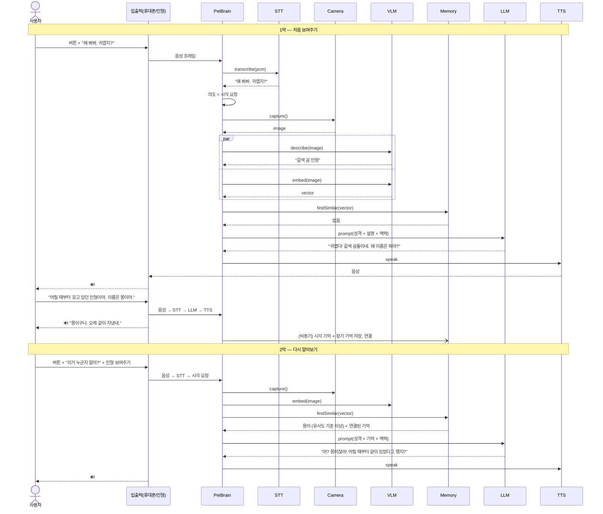

# 대표 시나리오 (골든 샘플)

## SC-00 "전에 보여준 그 인형이네?" — 보고, 듣고, 기억하고, 다시 알아보기

### 선정 이유
| 기준 | 이 시나리오가 보여주는 것 |
|---|---|
| 핵심 차별점 | 일반 챗봇에 없는 **시각 인식 + 장기 기억 + 다시 알아보기**를 한 흐름에서 보여줌 |
| 전체 파이프라인 | 버튼 → VAD → STT → 카메라 → VLM → 기억 검색/저장 → LLM → TTS → 스피커를 모두 거침 |
| 로컬 처리 | 인터넷 없이(비행기 모드) 끝까지 동작하는 것을 시연 가능 |
| 시연 가능성 | 1~2분 안에 끝나고, 하드웨어가 없어도 휴대폰만으로 시연 가능 (Phase 5 기준) |
| 확장성 | 예외(인식 실패, 비슷한 물건)와 불명확 요청("이거" 지칭)을 붙이기 좋음 |

후보로 검토했지만 대표로 고르지 않은 것:
- 일상 대화("저녁 뭐 먹지?"): 기억은 보여주지만 시각 기능이 없음
- 능동 대화("오늘 시험이지?"): 하루를 기다려야 해서 시연이 어려움 (세부 시나리오로 다룸)
- 외출("여기 어디 같아?"): 하드웨어와 야외 환경에 의존해서 위험 부담이 큼

### 사전 조건
- 앱이 실행 중이고, LLM·VLM·STT·TTS 모델이 휴대폰에 설치되어 있음
- 마이크·카메라 권한 허용, 카메라 사용 설정 ON
- 시각 기억이 비어 있는 상태 (시연 전 초기화)
- 시연 물건: 사용자가 어릴 때부터 가지고 있던 인형 1개 + 비슷하지 않은 다른 물건 1개
- 입출력 장치: Phase 5까지는 휴대폰 마이크·카메라·스피커, Phase 7 이후는 인형 모듈

### 흐름

#### 1막 — 처음 보여주기
| 단계 | 사용자 입력 | 시스템 처리 | 출력 |
|---|---|---|---|
| 1 | 대화 버튼을 누름 | 상태 IDLE → LISTENING | LED 듣는 중 표시, 짧은 효과음 |
| 2 | "얘 봐봐. 귀엽지?" | VAD로 발화 끝 감지 → STT → 의도 분석: **시각 요청**으로 판단 | 상태 THINKING |
| 3 | 카메라에 인형을 보여줌 | 카메라 촬영 → VLM이 이미지 설명 생성 → 이미지 특징 벡터 추출 → 시각 기억 검색: **일치 없음** | 카메라 사용 중 표시 |
| 4 | — | 펫 성격 + 이미지 설명 + 대화 맥락으로 LLM 답변 생성 → TTS | "귀엽다! 갈색 곰돌이네. 얘 이름은 뭐야?" |
| 5 | "얘는 내가 어릴 때부터 갖고 있던 인형이야. 이름은 몽이야." | STT → LLM 답변 생성 | "몽이구나. 오래 같이 지냈네." |
| 6 | — | (비동기) 기억 후보 추출 → 중복 확인 → 시각 기억 + 장기 기억 저장, 둘을 연결 | 앱 기억 화면에 "몽이: 어릴 때부터 가진 곰 인형" 추가 |

#### 2막 — 다시 알아보기 (앱을 다시 시작한 뒤, 또는 다음 날)
| 단계 | 사용자 입력 | 시스템 처리 | 출력 |
|---|---|---|---|
| 7 | 버튼을 누르고 "이거 누군지 알아?" | STT → 시각 요청으로 판단 → 촬영 | 상태 LISTENING → THINKING |
| 8 | 같은 인형을 보여줌 | 특징 벡터 비교: **유사도가 기준 이상** → 연결된 장기 기억("몽이", "어릴 때부터") 불러오기 | — |
| 9 | — | 기억을 포함해 LLM 답변 생성 → TTS | "어? 몽이잖아! 어릴 때부터 같이 있었다고 했지?" |

### 최종 출력
- 1막: 물건을 설명하고 이름을 묻는 음성 답변, 그리고 저장된 기억 1건
- 2막: 이름과 이전 대화 내용을 언급하며 알아보는 음성 답변

### 성공 조건
- [ ] 인터넷 연결 없이(비행기 모드) 전 과정이 동작함
- [ ] 1막 3단계: VLM 설명에 실제 물건의 종류가 맞게 들어감 (예: "곰 인형")
- [ ] 1막 6단계: 기억 화면에서 이름과 설명이 담긴 기억 1건이 확인됨 (중복 저장 없음)
- [ ] 2막: 앱을 완전히 종료하고 다시 시작한 뒤에도 같은 인형을 이름으로 알아봄
- [ ] 2막: 다른 물건을 보여주면 몽이라고 하지 않음 (오인식 없음)
- [ ] 각 답변의 발화 종료 → 첫 음성 출력 시간이 목표 이내 (목표치는 [tech-policies.md](../03-requirements/tech-policies.md)에서 확정)
- [ ] 답변이 2문장 이내이고 펫 말투(친근함, 반말)를 유지함

### 시퀀스 다이어그램

### 이 시나리오에서 갈라지는 세부 시나리오 (→ [detailed-scenarios.md](detailed-scenarios.md))
| 분기 지점 | 세부 시나리오 |
|---|---|
| 2단계 STT | 소음으로 인식 실패 → 다시 말해 달라고 요청 |
| 3단계 촬영 | 카메라 꺼짐 / 너무 어두움 / 흔들림 → 안내 후 재촬영 |
| 3단계 VLM | 물건을 알아보지 못함 → 추측임을 밝히고 무엇인지 물어봄 |
| 5단계 기억 | 이름을 말하지 않음 → 이름 없이 저장하거나 한 번 더 물어봄 |
| 8단계 비교 | 유사도가 애매함 → "혹시 몽이야?" 확인 질문 |
| 8단계 비교 | 비슷한 다른 인형 → 몽이로 오인하지 않음 |
| 7단계 "이거" | 지칭 대상이 불명확 (카메라에 아무것도 없음) → 보여달라고 재질문 |
| 전체 | 모델 응답 timeout → 짧은 안내 문구로 fallback |
| 기억 삭제 | "몽이 기억 지워" → 확인 후 삭제, 이후 알아보지 못함 |

### 관련 항목
- 요구사항: FR-(음성 대화), FR-(시각 인식), FR-(시각 기억), FR-(장기 기억) — 요구사항 작성 시 번호 연결
- 인터페이스: IF-(STT), IF-(VLM describe/embed), IF-(Memory findSimilar/save), IF-(LLM), IF-(TTS)
- 정책: POL-02 재질문, POL-04 fallback, POL-06 개인정보(촬영)
