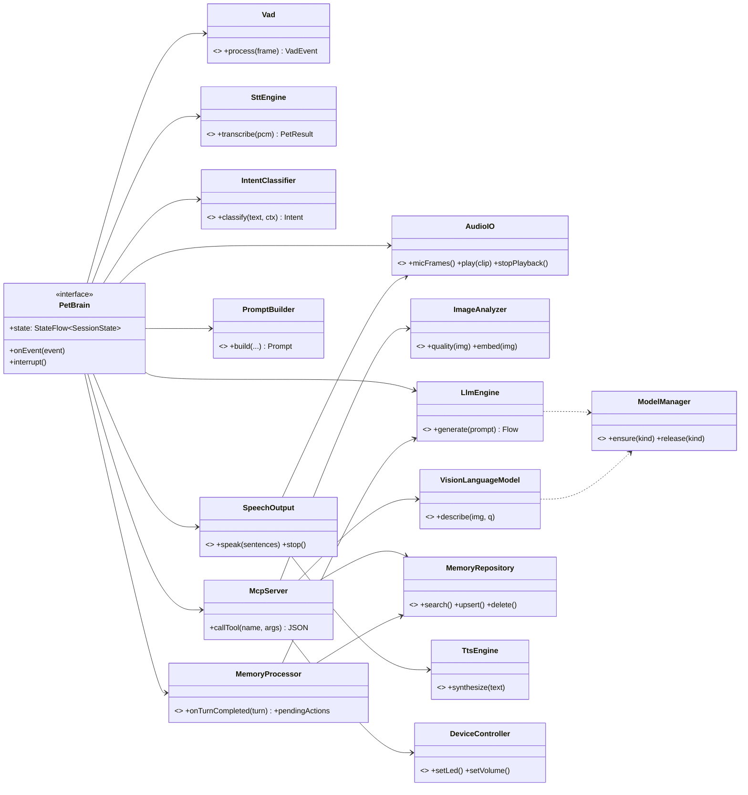

# 인터페이스 정의

번호 규칙: `IF-01~49` 레이어 간, `IF-51~` 레이어 내부
호출 방식: **Kotlin 호출**(suspend 함수 / Flow), **MCP**(JSON-RPC, 앱 내부), **BLE**(JSON 메시지), **Wi-Fi**(바이너리 스트림)

## 1. 인터페이스 목록

### 레이어 간
| ID | 호출자 → 대상 | 이름 | 호출 방식 | 동기/비동기 | Timeout |
|---|---|---|---|---|---|
| IF-01 | 하드웨어 → STT | 오디오 프레임 스트림 | Flow\<AudioFrame\> (인형은 Wi-Fi) | 비동기 스트림 | 프레임 끊김 2초 |
| IF-02 | 하드웨어 → LLM·MCP | 입력 이벤트 (버튼·터치·IMU·배터리) | Flow\<PetEvent\> (인형은 BLE) | 비동기 이벤트 | — |
| IF-03 | STT → 경량 모델 | 인식 결과 전달 | suspend 호출 | 동기 | 1.5초 |
| IF-04 | 경량 모델 → LLM·MCP | 의도 분류 결과 | suspend 반환 | 동기 | 100ms |
| IF-05 | LLM·MCP → 하드웨어 | 촬영 요청 `vision.capture` | MCP tool call | 동기 | 3초 |
| IF-06 | LLM·MCP → 경량 모델 | 이미지 품질 검사 + 임베딩 | suspend 호출 | 동기 | 500ms |
| IF-07 | LLM·MCP → 데이터 | 기억·시각 기억 조회/저장 `memory.*` | MCP tool call | 동기 | 300ms |
| IF-08 | LLM·MCP → 출력 모델 | 답변 문장 스트림 | Flow\<String\> | 비동기 스트림 | 첫 문장 6초 |
| IF-09 | LLM·MCP → 데이터 | 턴 종료 후 기억 처리 `TurnCompleted` (MemoryProcessor) | 이벤트 발행 (fire-and-forget) | 비동기 | 처리 30초 |
| IF-10 | MemoryProcessor → PetBrain | 확인 질문 대기열 / 능동 대화 트리거 | Flow\<PendingAction\> | 비동기 | — |
| IF-11 | 출력 모델 → 하드웨어 | 음성 재생 | suspend 호출 (인형은 Wi-Fi) | 비동기(재생 완료 대기 가능) | 문장 길이 + 2초 |
| IF-12 | LLM·MCP → 하드웨어 | 기기 제어 (LED·볼륨·절전) | MCP tool call → BLE | 비동기 | 1초, 응답 없으면 무시 |

### 레이어 내부
| ID | 레이어 | 이름 | 호출 방식 | 동기/비동기 | Timeout |
|---|---|---|---|---|---|
| IF-51 | STT | VAD 프레임 처리 | 일반 함수 | 동기 | 프레임당 5ms |
| IF-52 | STT | STT 엔진 인식 | suspend | 동기 | 1.5초 |
| IF-53 | 경량 모델 | 의도 분류 | suspend | 동기 | 100ms |
| IF-54 | 경량 모델 | 이미지 임베딩 | suspend | 동기 | 300ms |
| IF-55 | LLM·MCP | 대화 상태 머신 전이 | StateFlow | 동기 | 상태별 (아래 참고) |
| IF-56 | LLM·MCP | 프롬프트 구성 | 일반 함수 | 동기 | — |
| IF-57 | LLM·MCP | LLM 생성 | Flow\<String\> | 비동기 스트림 | 첫 토큰 3초, 전체 15초 |
| IF-58 | LLM·MCP | VLM 설명 | suspend | 동기 | 8초 |
| IF-59 | LLM·MCP | 모델 로딩/해제 | suspend | 동기 | 20초 |
| IF-60 | LLM·MCP (MemoryProcessor) | 기억 후보 추출 | suspend | 동기(백그라운드) | 20초 |
| IF-61 | LLM·MCP (MemoryProcessor) | 중복·충돌 판단 | suspend | 동기 | 500ms |
| IF-62 | LLM·MCP (MemoryProcessor) | 펫 상태 갱신 | suspend | 동기 | 100ms |
| IF-63 | 출력 모델 | 문장 분할 | Flow 변환 | 비동기 | — |
| IF-64 | 출력 모델 | TTS 합성 | suspend | 동기 | 문장당 2초 |

## 2. 공통 규칙

### 결과 타입
```kotlin
sealed interface PetResult<out T> {
    data class Ok<T>(val value: T, val latencyMs: Long) : PetResult<T>
    data class Err(val code: ErrorCode, val message: String, val retryable: Boolean) : PetResult<Nothing>
}
```

### 오류 코드
| 코드 | 의미 | 기본 처리 |
|---|---|---|
| `TIMEOUT` | 제한 시간 초과 | 취소 → fallback 문구 (POL-04) |
| `LOW_CONFIDENCE` | 결과 신뢰도 부족 | 재요청 또는 추측임을 밝힘 |
| `EMPTY_INPUT` | 입력 없음 | 재요청 |
| `PERMISSION_DENIED` | 카메라·마이크 권한/설정 OFF | 안내, 실행하지 않음 |
| `DEVICE_DISCONNECTED` | 인형 연결 끊김 | 휴대폰 장치로 전환 |
| `LOW_QUALITY` | 사진 어두움/흔들림 | 1회 재촬영 → 안내 |
| `OUT_OF_MEMORY` | 모델 로딩 실패 | VLM 해제 후 재시도 |
| `NEEDS_CONFIRMATION` | 사용자 확인 필요 | CONFIRMING 상태로 |
| `NOT_FOUND` | 대상 없음 | 재질문 |
| `INTERNAL` | 그 외 | 로그 + 일반 사과 문구 |

### Timeout · 재시도 원칙
- 모든 suspend 호출은 `withTimeout`으로 감싼다. 위 표의 값이 기본값이며 [tech-policies.md](../03-requirements/tech-policies.md)에서 최종 확정한다.
- 자동 재시도는 `retryable = true`일 때 **최대 1회**. 사용자에게 다시 요청하는 것은 정책(POL-02)을 따른다.
- 사용자가 끼어들면 진행 중인 모든 작업은 `CancellationException`으로 취소한다. 이는 오류로 보지 않는다.

### 상태별 Timeout (IF-55)
| 상태 | Timeout | 초과 시 |
|---|---|---|
| LISTENING (무발화) | 5초 | IDLE |
| THINKING | 10초 | fallback 문구 → IDLE |
| LOOKING | 10초 | "잘 안 보였어" → IDLE |
| CONFIRMING | 8초 | 취소로 처리 → IDLE |

---

## 3. 레이어 간 인터페이스 상세

### IF-01 오디오 프레임 스트림 (하드웨어 → STT)
```kotlin
interface AudioIO {
    fun micFrames(): Flow<AudioFrame>
    suspend fun play(clip: AudioClip)
    fun stopPlayback()
}
data class AudioFrame(val pcm: ShortArray, val sampleRate: Int = 16_000, val timestampMs: Long)
```
- 입력: 없음 / 출력: 30ms 단위 PCM 프레임
- 오류: 2초 이상 프레임이 없으면 `DEVICE_DISCONNECTED` → 휴대폰 마이크로 전환

### IF-02 입력 이벤트 (하드웨어 → LLM·MCP)
```kotlin
sealed interface PetEvent {
    data object ButtonPressed : PetEvent
    data object WakeWord : PetEvent
    data class Touched(val zone: String, val durationMs: Int) : PetEvent
    data class Motion(val kind: String) : PetEvent
    data class Battery(val percent: Int, val charging: Boolean) : PetEvent
    data class Connection(val state: ConnectionState) : PetEvent
}
```
- 인형에서 올 때는 BLE JSON 메시지 ([api-examples/IF-02_button.ble.json](api-examples/IF-02_button.ble.json))

### IF-03 · IF-52 STT 인식
```kotlin
interface SttEngine {
    suspend fun transcribe(pcm: ShortArray, sampleRate: Int = 16_000): PetResult<SttResult>
}
data class SttResult(val text: String, val confidence: Float, val language: String = "ko")
```
- 오류: 빈 결과 `EMPTY_INPUT`, 신뢰도 미달 `LOW_CONFIDENCE` → LLM 호출하지 않고 재요청 (SC-11)

### IF-04 · IF-53 의도 분류
```kotlin
interface IntentClassifier {
    suspend fun classify(text: String, context: List<ChatMessage>): Intent
}
data class Intent(val type: IntentType, val confidence: Float, val slots: Map<String, String> = emptyMap())
enum class IntentType { CHAT, VISION, MEMORY_QUERY, MEMORY_SAVE, MEMORY_DELETE, MEMORY_UPDATE, SCHEDULE, UNKNOWN }
```
- `slots` 예: `{"target": "몽이"}`, `{"date": "2026-11-05"}`
- `UNKNOWN`이거나 신뢰도가 낮으면 `CHAT`으로 처리하고 LLM에 맡긴다.

### IF-05 촬영 `vision.capture` (MCP)
- 입력: `{ "resolution": "VGA" }`
- 출력: `{ "imageId": "...", "brightness": 0.0~1.0, "sharpness": 0.0~1.0, "quality": "OK|DARK|BLURRY" }`
- 오류: `PERMISSION_DENIED`(설정 OFF, 촬영 시도 자체를 안 함), `LOW_QUALITY`, `TIMEOUT`
- 예시: [IF-05_vision.capture](api-examples/)

### IF-06 · IF-54 품질 검사 + 임베딩
```kotlin
interface ImageAnalyzer {
    fun quality(image: Bitmap): ImageQuality
    suspend fun embed(image: Bitmap): PetResult<FloatArray>
}
data class ImageQuality(val brightness: Float, val sharpness: Float, val ok: Boolean)
```

### IF-07 기억 도구 `memory.*` (MCP)
| 도구 | 입력 | 출력 | 확인 필요 |
|---|---|---|---|
| `memory.search` | `query`, `limit` | `Memory[]` | — |
| `memory.save` | `type`, `content`, `visualMemoryId?` | `id` | — |
| `memory.update` | `id`, `content`, `confirmed` | `id` | `confirmed=false`면 `NEEDS_CONFIRMATION` |
| `memory.delete` | `id`, `confirmed` | `deletedCount` | `confirmed=false`면 `NEEDS_CONFIRMATION` |
| `vision.match` | `imageId` | `{ match: VisualMemory?, similarity, decision: SAME/AMBIGUOUS/NEW }` | — |

- 예시: [IF-07_vision.match](api-examples/)

### IF-08 답변 문장 스트림 (LLM·MCP → 출력 모델)
```kotlin
interface SpeechOutput {
    suspend fun speak(sentences: Flow<String>, voice: String = "default"): PetResult<Unit>
    fun stop()
}
```
- 첫 문장이 6초 안에 오지 않으면 `TIMEOUT` → fallback 문구를 대신 말함

### IF-09 턴 종료 후 기억 처리 (PetBrain → MemoryProcessor)
```kotlin
data class TurnCompleted(
    val turnId: String,
    val userText: String,
    val petText: String,
    val intent: IntentType,
    val vision: VisionContext?,   // 촬영했다면 imageId, 설명, 매칭 결과
    val timestamp: Instant,
)
interface MemoryProcessor {
    fun onTurnCompleted(turn: TurnCompleted)          // 즉시 반환, 내부 큐에서 처리
    val pendingActions: Flow<PendingAction>           // IF-10
}
```
- 실패해도 사용자에게 알리지 않는다. 로그만 남기고 다음 턴에 영향을 주지 않는다.

### IF-10 대기 작업 (MemoryProcessor → PetBrain)
```kotlin
sealed interface PendingAction {
    data class ConfirmMemoryUpdate(val memoryId: Long, val oldValue: String, val newValue: String) : PendingAction
    data class Proactive(val message: String, val reason: String, val notBefore: Instant) : PendingAction
}
```
- PetBrain은 IDLE이고 정책(POL-05)이 허용할 때만 처리한다.

### IF-11 음성 재생 / IF-12 기기 제어
```kotlin
interface DeviceController {
    suspend fun setLed(pattern: LedPattern)
    suspend fun setVolume(level: Int)
    suspend fun sleep(deep: Boolean)
}
enum class LedPattern { OFF, IDLE, LISTENING, THINKING, LOOKING, SPEAKING, CONFIRMING, LOW_BATTERY }
```
- 기기 제어는 응답이 없어도 대화 흐름을 막지 않는다.

---

## 4. 레이어 내부 인터페이스 상세

### IF-51 VAD
```kotlin
interface Vad {
    fun process(frame: AudioFrame): VadEvent?   // SPEECH_START / SPEECH_END / null
    fun reset()
}
```

### IF-55 대화 상태 머신
```kotlin
interface PetBrain {
    val state: StateFlow<SessionState>
    suspend fun onEvent(event: PetEvent)
    suspend fun handleText(text: String): Flow<String>   // 텍스트 채팅 (Phase 1)
    fun interrupt()
}
enum class SessionState { IDLE, LISTENING, THINKING, LOOKING, SPEAKING, CONFIRMING, ERROR }
```

### IF-56 프롬프트 구성
```kotlin
interface PromptBuilder {
    fun build(persona: Persona, state: PetState, memories: List<Memory>,
              history: List<ChatMessage>, input: String, vision: VisionContext?): Prompt
}
```
- 프롬프트 길이 상한을 넘으면 오래된 대화부터 잘라낸다. 기억은 최대 5개.

### IF-57 LLM / IF-58 VLM / IF-59 모델 관리
```kotlin
interface LlmEngine {
    fun generate(prompt: Prompt, params: GenParams = GenParams()): Flow<String>
}
interface VisionLanguageModel {
    suspend fun describe(image: Bitmap, question: String?): PetResult<VisionDescription>
}
data class VisionDescription(val text: String, val objects: List<String>, val confidence: Float)
interface ModelManager {
    suspend fun ensure(kind: ModelKind): PetResult<Unit>
    suspend fun release(kind: ModelKind)
}
```

### IF-60 ~ IF-62 MemoryProcessor 내부
```kotlin
interface MemoryExtractor { suspend fun extract(turn: TurnCompleted): List<MemoryCandidate> }
interface MemoryJudge     { suspend fun judge(c: MemoryCandidate): MemoryDecision }   // ADD/UPDATE/HOLD/IGNORE/ASK_USER
interface PetStateStore   { val state: StateFlow<PetState>; suspend fun apply(turn: TurnCompleted) }
```

### IF-63 · IF-64 출력 내부
```kotlin
interface SentenceSplitter { fun split(tokens: Flow<String>): Flow<String> }
interface TtsEngine        { suspend fun synthesize(text: String, voice: String): PetResult<AudioClip> }
```

---

## 5. 클래스 다이어그램



## 6. 요청·응답 예시

[api-examples/](api-examples/) 폴더 참고

| 파일 | 내용 |
|---|---|
| `IF-05_vision.capture.request.json` / `.response.json` | 촬영 요청과 품질 결과 |
| `IF-07_vision.match.request.json` / `.response.json` | 대표 시나리오 2막: 몽이 알아보기 |
| `IF-07_memory.delete.error.json` | 확인 없이 삭제 시도 → `NEEDS_CONFIRMATION` |
| `IF-09_turn-completed.json` | 대표 시나리오 1막 턴 종료 이벤트 |
| `IF-02_button.ble.json` | 인형 버튼 BLE 메시지 |
