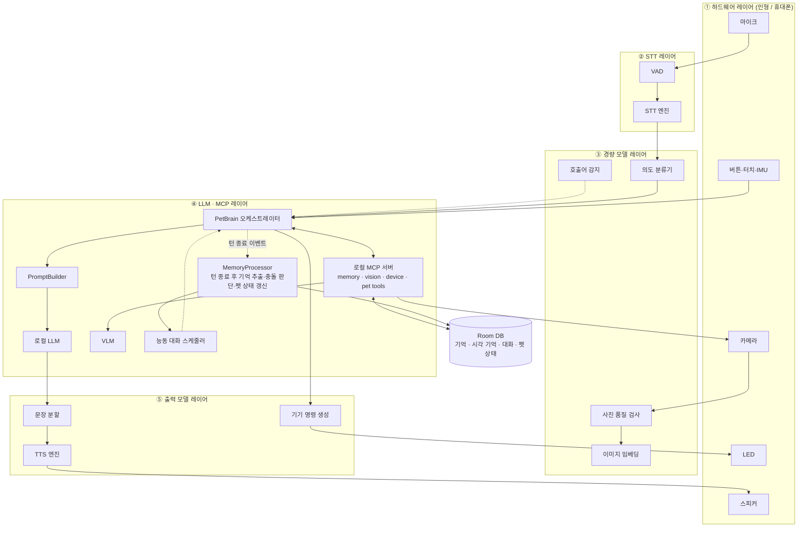

# 레이어 구성

> **해석 전제 (확인 필요)**
> - **MCP** = Model Context Protocol. LLM이 기억·카메라·기기 같은 기능을 "도구(tool)"로 호출하는 규격으로 해석했다. 앱 안에서 동작하는 로컬 MCP 서버로 둔다.

## 1. 컴포넌트 다이어그램

## 2. 레이어별 역할과 책임

| # | 레이어 | 역할 | 책임 (하는 일) | 하지 않는 일 | 실행 위치 | 후보 기술 |
|---|---|---|---|---|---|---|
| ① | 하드웨어 | 세상과 물리적으로 연결 | 음성 수집, 촬영, 소리 출력, 버튼·터치·움직임 감지, LED 표시, 배터리 보고 | AI 판단 | 휴대폰 → (Phase 6+) 인형 ESP32-S3 | AudioRecord, CameraX, BLE, Wi-Fi |
| ② | STT | 말을 글로 | 발화 시작·끝 감지, 음성 → 텍스트, 신뢰도 산출 | 의미 해석 | 로컬 | Silero VAD, SenseVoice (sherpa-onnx) |
| ③ | 경량 모델 | 빠르고 싼 판단 | 의도 분류, 이미지 특징 벡터, 사진 품질(밝기·흔들림), 호출어 | 답변 생성 | 로컬 | 규칙 + 소형 분류기, 경량 이미지 임베딩 모델 |
| ④ | LLM · MCP | 생각하고 도구를 쓰고 기억함 | 대화 흐름 지휘, 프롬프트 구성, 답변 생성, 이미지 설명, 도구 호출(기억 검색·촬영·기기 제어), 턴 종료 후 기억 추출·충돌 판단·펫 상태 갱신(비동기), 능동 대화 예약 | — | 로컬 | llama.cpp + Qwen3-1.7B/4B, Qwen3-VL-2B, MCP(로컬 in-process) |
| ⑤ | 출력 모델 | 글을 말과 동작으로 | 문장 단위 분할, 음성 합성, 재생 중단, LED·볼륨 명령 생성 | 내용 결정 | 로컬 | Supertonic-3-ko (sherpa-onnx) |
| — | 데이터 | 기억의 저장소 | 기억·시각 기억·대화·펫 상태·설정 영구 저장, FTS 검색 | — | 휴대폰 로컬 | Room / SQLite FTS |

## 3. 레이어 상세

### ① 하드웨어
- 구현체를 바꿔 끼우는 구조: `PhoneAudioIO` / `BtHeadsetAudioIO` / `DollAudioIO`, `PhoneCamera` / `DollCamera`
- 인형 ↔ 휴대폰: 제어·센서는 BLE JSON, 이미지·오디오는 Wi-Fi (Phase 6에서 확정)
- 카메라는 **요청이 있을 때만** 켠다. 상시 촬영하지 않는다.

### ② STT
- 입력: 16kHz mono PCM 프레임(30ms). 출력: 텍스트 + 신뢰도.
- 신뢰도가 기준 미만이거나 결과가 비면 LLM으로 넘기지 않는다. (SC-11)
- 펫이 말하는 동안에는 스피커 소리가 다시 들어가지 않도록 에코 제거 또는 입력 게이트를 둔다. (SC-16)

### ③ 경량 모델
- **의도 분류**: `CHAT` / `VISION` / `MEMORY_QUERY` / `MEMORY_DELETE` / `MEMORY_UPDATE` / `SCHEDULE` / `UNKNOWN`. 처음엔 키워드 규칙("이거", "봐봐", "지워", "기억해")으로 시작하고, 부족하면 소형 분류기로 바꾼다.
- **이미지 임베딩**: 같은 물건인지 비교하는 특징 벡터. VLM보다 훨씬 빨라야 한다.
- **사진 품질 검사**: 밝기 평균, 라플라시안 분산(흔들림). 기준 미달이면 재촬영. (SC-12)
- 목적: 무거운 LLM·VLM 호출을 줄여 응답 시간과 발열을 줄인다.

### ④ LLM · MCP
- **PetBrain**이 상태 머신(IDLE → LISTENING → THINKING → LOOKING → SPEAKING → CONFIRMING)을 가진다.
- 시연 안정성을 위해 **의도가 분명하면 PetBrain이 도구를 직접 호출**하고, 애매할 때만 LLM이 MCP 도구를 고르게 한다. (소형 LLM의 도구 호출 정확도 대비)
- MCP 도구 목록

| 도구 | 기능 | 확인 필요 |
|---|---|---|
| `memory.search` | 장기 기억 텍스트 검색 | 아니오 |
| `memory.save` | 기억 저장 | 아니오 |
| `memory.update` | 기억 수정 | **예** (SC-24) |
| `memory.delete` | 기억 삭제 | **예** (SC-04, 25) |
| `vision.capture` | 촬영 + 품질 검사 | 카메라 설정 ON일 때만 |
| `vision.describe` | VLM 이미지 설명 | 아니오 |
| `vision.match` | 시각 기억 유사도 검색 | 아니오 |
| `device.led` / `device.volume` | 인형 제어 | 아니오 |
| `pet.state` | 펫 상태 조회 | 아니오 |

- RAM 관리: `ModelManager`가 LLM은 상주시키고, VLM은 시각 요청 때만 올렸다가 일정 시간 미사용 시 내린다.

- **MemoryProcessor (턴 종료 후 기억 처리)**: 턴이 끝나면 `TurnCompleted` 이벤트를 받아 **백그라운드에서** 처리한다. 사용자 응답 시간에 영향을 주지 않는다.
- 단계: 기억 후보 추출 → 중요도·신뢰도 점수 → 기존 기억과 비교 → `ADD` / `UPDATE` / `HOLD` / `IGNORE` / `ASK_USER`
- `ASK_USER`(충돌)는 바로 저장하지 않고 다음 턴에 PetBrain이 확인 질문을 하도록 대기열에 넣는다. (SC-24)
- 일정 기억이 생기면 능동 대화를 예약한다. (SC-05)
- 펫 상태(친밀도·기분 등)를 규칙에 따라 갱신한다.

### ⑤ 출력 모델
- LLM 토큰 스트림을 문장 단위로 잘라 **첫 문장이 완성되는 즉시** 합성을 시작한다. (첫 음성까지의 시간 단축)
- `stop()` 호출 시 재생 중인 음성과 대기 중인 문장을 모두 버린다. (SC-16)
- TTS가 실패하면 미리 녹음한 효과음과 앱 화면 텍스트로 대신한다. (SC-15)
- 상태 변화에 맞춰 LED 패턴 명령을 생성한다.
